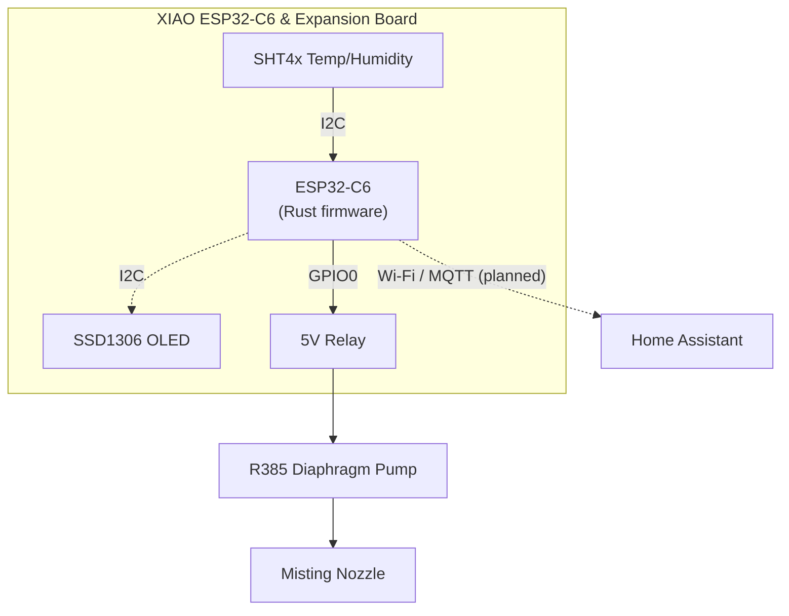

# Iso Mist — Automatic Isopod Misting System

Bare-metal (`no_std`) async Rust firmware for a **Seeed Studio XIAO ESP32-C6** that keeps an isopod (terrarium) enclosure at a target humidity band. The firmware polls a temperature/humidity sensor over I2C, shows live readings on the onboard OLED, and drives a relay that switches a diaphragm pump when humidity falls too low.

The project is an educational embedded-Rust build: everything is written against `esp-hal`, `embassy`, and hardware-abstraction traits, with no RTOS and no dynamic allocation in the control path.

> **Status:** In development. Sensor polling, OLED display, and relay hysteresis control are implemented in `src/bin/main.rs`. Wi-Fi / Home Assistant telemetry is part of the roadmap and dependencies are staged but not yet wired into the main loop.

---

## What it does

1. Every second, read temperature and humidity from an **SHT4x** sensor over a shared I2C bus.
2. Render the reading on a **128×64 SSD1306 OLED** (also on the shared bus).
3. Apply **hysteresis** to the relay so the pump does not chatter:
   - Turn the pump **on** when humidity drops below **55 %**.
   - Turn it **off** once humidity reaches **70 %**.
4. Emit logs over RTT via `defmt`.

If the sensor read fails, the OLED shows an error message and the control loop continues.

---

## Hardware

| Role | Part |
| --- | --- |
| MCU / board | Seeed Studio XIAO ESP32-C6 |
| Carrier | Seeed Studio XIAO Expansion Board (built-in OLED) |
| Sensor | SHT40 / SHT31-D temperature & humidity, I2C |
| Display | SSD1306 128×64 OLED, I2C |
| Actuator | 5 V single-channel relay → R385 diaphragm pump |
| Plumbing | 1/4" pneumatic tubing, reptile misting nozzle |
| Power | 12 V DC supply (pump), 5 V logic |

### Pin mapping (from `src/bin/main.rs`)

| Signal | GPIO | Notes |
| --- | --- | --- |
| I2C SDA | GPIO22 | shared bus: sensor + OLED |
| I2C SCL | GPIO23 | shared bus: sensor + OLED |
| Relay control | GPIO0 | `Level::Low` = pump off at boot |

### Bill of materials

| Qty | Component | Notes |
| --- | --- | --- |
| 1 | Seeed Studio XIAO ESP32-C6 | main MCU |
| 1 | Seeed Studio XIAO Expansion Board | built-in SSD1306 OLED and Grove I2C |
| 1 | SHT31-D temp/humidity sensor | I2C; firmware currently uses an SHT4x driver |
| 1 | 5 V 1-channel relay module | switched from GPIO0 |
| 1 | 12 V DC power supply | pump supply |
| 1 | R385 diaphragm pump | driven through the relay |
| 1 | Reptile misting nozzle | |
| — | 1/4" pneumatic tubing | pump → nozzle run |

### Block diagram



---

## Repository layout

```
.
├── src/
│   ├── bin/main.rs        # firmware entry point: I2C bus, sensor, OLED, relay logic
│   └── lib.rs             # empty no_std lib (test scaffolding)
├── tests/
│   └── hello_test.rs      # embedded-test harness running on the target
├── build.rs               # linker args (defmt, linkall) + friendlier link errors
├── docs/
│   ├── MWH_Isopod_Mister.md          # project objectives / system description
│   ├── Terrarium_Mister_Rust_Roadmap.md  # 6-week phased plan
│   └── MWH_Project_Report.md         # report outline
├── flake.nix              # pinned dev shell (rustc, riscv32 target, probe-rs, espflash)
├── Embed.toml             # probe-rs / cargo-embed config (JTAG, chip=esp32c6, RTT)
└── Cargo.toml             # esp-hal, embassy, defmt, drivers
```

---

## Development environment

The toolchain is pinned per-repo with a Nix flake and `direnv`, so `cargo` can cross-compile to `riscv32imac-unknown-none-elf` without rustup or a `rust-toolchain.toml`.

```bash
# If direnv is installed, just enter the directory:
cd iso_mist

# Otherwise, enter the shell manually:
nix develop
```

The shell provides:

- Rust with the `riscv32imac-unknown-none-elf` target
- `probe-rs-tools` (used as the Cargo runner)
- `espflash` (standalone flasher)
- `picocom` (serial monitor)

---

## Build, flash, and run

`.cargo/config.toml` sets the default target and routes `cargo run` through probe-rs:

```bash
cargo build            # compile for the ESP32-C6
cargo run              # flash + attach RTT via probe-rs (runner)
```

Standalone flashing/monitoring alternatives:

```bash
cargo espflash flash --monitor      # espflash
picocom -b 115200 /dev/ttyACM0      # plain serial
```

`Embed.toml` configures `cargo-embed` for JTAG with RTT channel 0 formatted as `defmt`.

### Tests

`tests/hello_test.rs` uses [`embedded-test`](https://github.com/probe-rs/embedded-test) and runs on real hardware:

```bash
cargo test
```

---

## Key crates

| Crate | Purpose |
| --- | --- |
| `esp-hal` | low-level ESP32-C6 peripheral access |
| `esp-rtos` | starts the async runtime / timers on the chip |
| `embassy-executor`, `embassy-time` | async task executor and timers |
| `embassy-net`, `esp-radio` | TCP/IP stack and Wi-Fi radio (roadmap: MQTT/HA) |
| `sht4x` | async SHT4x sensor driver |
| `ssd1306` + `embedded-graphics` | OLED driver and text rendering |
| `embedded-hal-bus` | `RefCellDevice` for sharing one I2C bus across two devices |
| `heapless` | fixed-capacity `String` — no heap in the display path |
| `defmt`, `defmt-rtt`, `esp-backtrace` | logging, RTT transport, panic backtraces |

---

## Roadmap

The project follows the six-week plan in `docs/Terrarium_Mister_Rust_Roadmap.md`. The milestone names below match that document:

- **Milestone 1 — Bare-Metal Setup & Hardware I/O** (toolchain, `no_std` skeleton, I2C sensor reads, relay switching)
- **Milestone 2 — Async Architecture & Safety State Machine** (embassy timers, hysteresis/lockout state machine, `heapless` data)
- **Milestone 3 — Wireless Connectivity & Home Assistant Integration** (Wi-Fi via `esp-radio`, MQTT telemetry and auto-discovery)
- **Milestone 4 — Hardware Integration & Enclosure Polish** (solder, enclosure, soak test)

---

## Notes for contributors

- Keep the control path `no_std` and allocation-free; prefer `heapless` over `alloc` in the loop.
- All I2C peripherals share one bus through `embedded_hal_bus::i2c::RefCellDevice`.
- The sensor driver currently used is `sht4x` (SHT40); the project brief also lists an SHT31-D — reconcile the sensor part before ordering.

---

## References

- The Embedded Rust Book — <https://docs.rust-lang.org/stable/embedded-book/>
- ESP32-C6 async Rust book — <https://esp32.implrust.com/embassy>
- `esp-hal` examples — <https://github.com/esp-rs/esp-hal>
- Home Assistant MQTT discovery — <https://www.home-assistant.io/integrations/mqtt/#mqtt-discovery>
