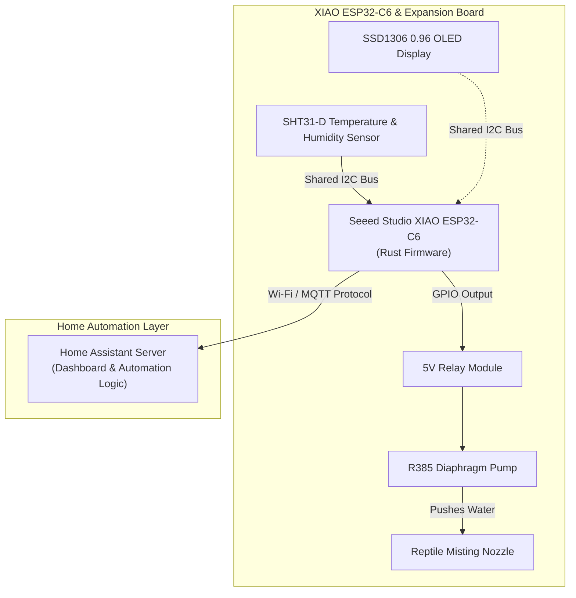

### Project Objectives

The Objective of this term project is to implement an automatic misting system
designed to keep an isopod enclosure at the proper humidity level with minimal oversight
from the keeper.

### System Operations

The system will operate using an ESP32-C6 as the processing center, where it will
periodically poll an environmental sensor to check the humidity against preset parameters. If
the humidity has fallen below the lower threshold, the ESP will send a signal to a relay
which will trigger a diaphragm pump to run for a defined amount of time. The environmental sensor will then be polled again and the cycle will repeat if needed until
the humidity reaches a cutoff threshold. Readings will be displayed on the Seeed Studio
XIAO expansion boards built-in display. Home Assistant will be integrated allowing the
user to view the last polled sensor readings, trigger manual misting actions, and view
historic graphs of the systems activity.

### Hardware Components

- Seeed Studio XIAO ESP32-C6
- Seeed Studio XIAO Expansion Board with Built in OLED
- SHT31-D Temperature and Humidity Sensor
- 5V 1 Channel Relay
- 12V DC Power Supply
- R385 Diaphragm Pump
- Reptile Misting Nozzle
- 1/4 inch Pneumatic Tubing

### Expected inputs and outputs

The expected utilized inputs will be the I2C inputs SCL and SDA for reading the environmental data from the
SHT31-D sensor.

The expected outputs to be used are GPIO pins used to send switching signals to the
relay, the I2C shared bus for the OLED display.

WiFi will also be used to connect to the network, and MQTT will be used to send
telemetry messages back to the Home Assistant Server.

### Block Diagram

### Challenges and Risks

The main challenge is my desire to write the program using bare-metal embedded Rust, a language I
have no previous experience with. If this proves to be too much of a challenge to
complete in the provided timeline, I will fall back to using C++ and Arduino libraries
in order to meet the deadline.
