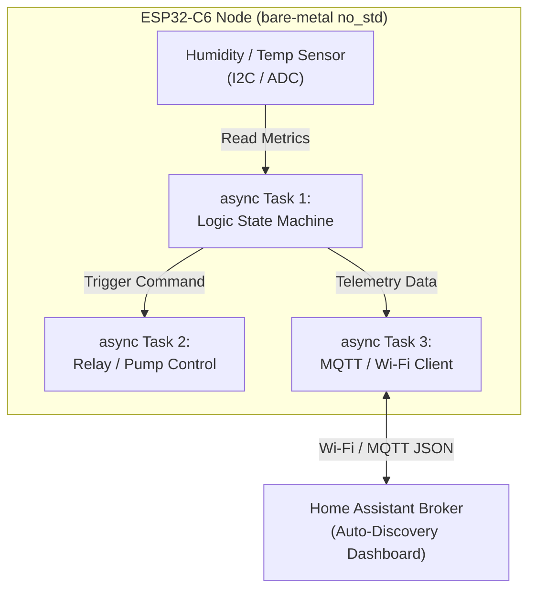
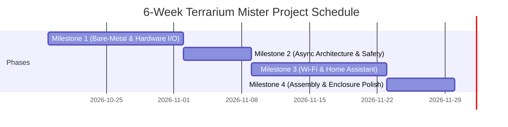

# Bare-Metal Embedded Rust Roadmap
## ESP32-C6 Automated Terrarium Mister & Home Assistant Node
**Project Duration:** 6 Weeks  
**Primary Target:** ESP32-C6 (Development) $\rightarrow$ ESP32-C3 / Xteink X4 (Future Application)  
**Execution Strategy:** Bare-metal (`no_std`), Async Rust (`embassy`), Direct Peripherals (`esp-hal`), Native Espressif Tooling  

---

## 1. Project Overview & Architecture

The objective of this project is to build a reliable, bare-metal, async Rust-powered automated terrarium mister using an ESP32-C6 microcontroller. The device monitors environmental metrics, controls a water pump via relay logic, and seamlessly reports state and sensor telemetry to a local Home Assistant instance using MQTT auto-discovery over Wi-Fi.



---

## 2. Recommended Resources & Cited Reference List

When developing without high-level AI code generation or heavy OS abstractions, consult these primary documentation sources.

### Core Resources Reference List

*   **[R1] The Embedded Rust Book** — *docs.rust-lang.org/stable/embedded-book/*
    *   *Key Sections:* "A `no_std` Executive Summary", "Peripherals", "Concurrency", "Collections without `std`".
*   **[R2] The ESP32 Async Book** — *esp32.implrust.com/embassy*
    *   *Key Sections:* "Setting up Embassy", "Async Drivers", "Concurrency with `embassy-executor`", "Networking with `esp-wifi`".
*   **[R3] `esp-hal` Official Code Examples & Repository** — *github.com/esp-rs/esp-hal*
    *   *Key Sections:* `examples/src/bin/embassy_*.rs`, `examples/src/bin/wifi_*.rs`, `examples/src/bin/i2c_*.rs`.
*   **[R4] `esp-wifi` Official Documentation** — *docs.espressif.com/projects/rust/esp-wifi*
    *   *Key Sections:* "Embassy Integration", "Wi-Fi Configuration", "`smoltcp` stack initialization".
*   **[R5] Home Assistant MQTT Discovery Specification** — *home-assistant.io/integrations/mqtt/#mqtt-discovery*
    *   *Key Sections:* "Discovery Messages", "Sensor Configuration Payload", "Switch / Relay Commands".
*   **[R6] Espressif ESP32-C6 Technical Reference Manual (TRM)** — *https://documentation.espressif.com/esp32-c6_technical_reference_manual_en.pdf*
    *   *Key Sections:* "GPIO Matrix and Pin Mux", "I2C Controller", "ADC (Analog to Digital Converter)", "System Clocks".

---

## 3. Six-Week Timeline & Phase Breakdown



### Milestone 1: Bare-Metal Setup & Hardware I/O (Weeks 1–2)
*Focus: Toolchain, `no_std`, peripheral drivers, and physical actuator control.*

*   **Task 1.1:** Ditch IDE wrappers like PlatformIO. Install native tooling (`cargo-espflash`, `esp-generate`, `riscv32imac-unknown-none-elf` target) [R1].
*   **Task 1.2:** Initialize a `no_std` project template using `esp-generate` targeting the ESP32-C6 [R3].
*   **Task 1.3:** Wire a digital sensor or analog soil moisture probe to an ADC channel or I2C pin on the ESP32-C6. Read raw voltage/data registers using `esp-hal` drivers [R3, R6].
*   **Task 1.4:** Wire a 5V relay module (driving the mister pump) to a dedicated GPIO pin. Implement manual toggle logic to verify relay switching threshold and coil safety [R6].

#### Deliverables (End of Week 2):
1. A working bare-metal binary compiling cleanly under `riscv32imac-unknown-none-elf`.
2. A stand-alone module reading analog/I2C sensor inputs and logging metric values over RTT/USB serial [R1].
3. A functional GPIO driver module capable of safely energizing and de-energizing the relay.

---

### Milestone 2: Async Architecture & Safety State Machine (Week 3)
*Focus: Non-blocking timers, state control, and crash safety.*

*   **Task 2.1:** Integrate the `embassy-executor` and `embassy-time` crates into your `no_std` project [R2].
*   **Task 2.2:** Replace blocking delay loops with async `Timer::after().await` calls so the CPU stays responsive during long wait times [R2].
*   **Task 2.3:** Implement an automated terrarium state machine:
    *   *Monitor:* Measure humidity/moisture levels continuously.
    *   *Active Mister:* Trigger relay for $X$ seconds if metric falls below threshold.
    *   *Cooldown / Lockout:* Force a minimum $Y$-minute lockout period to prevent tank flooding and pump overheating.
*   **Task 2.4:** Utilize `heapless` fixed-capacity data structures to eliminate any need for dynamic memory allocation (`alloc`) [R1].

#### Deliverables (End of Week 3):
1. An async main loop managing sensor polling and pump triggering concurrently.
2. Verified safety lockout state machine logic preventing accidental continuous pumping.

---

### Milestone 3: Wireless Connectivity & Home Assistant Integration (Weeks 4–5)
*Focus: Wi-Fi stack, MQTT client, and zero-code Home Assistant integration.*

*   **Task 3.1:** Initialize the `esp-wifi` crate within an async `embassy` task [R2, R4].
*   **Task 3.2:** Connect to your local 2.4 GHz Wi-Fi network and obtain a static/DHCP IP address using `smoltcp` [R4].
*   **Task 3.3:** Configure an embedded MQTT client (e.g., `minimq`) to establish a persistent socket connection to your local Mosquitto MQTT broker [R2].
*   **Task 3.4:** Implement Home Assistant **MQTT Auto-Discovery** [R5]:
    *   Publish a JSON payload on startup to `homeassistant/sensor/terrarium_humidity/config`.
    *   Publish a switch JSON payload to `homeassistant/switch/terrarium_mister/config` to allow remote overrides from your smartphone.
*   **Task 3.5:** Stream telemetry updates (`{"humidity": 68.5, "pump": "OFF"}`) on a fixed async schedule [R5].

#### Deliverables (End of Week 5):
1. ESP32-C6 automatically connecting to local Wi-Fi on boot.
2. Auto-discovery payloads generated and received by Home Assistant, automatically generating dashboard controls without server YAML edits [R5].
3. Two-way communication: Sensor data streaming out to dashboard, manual misting commands streaming in to relay.

---

### Milestone 4: Hardware Integration & Enclosure Polish (Week 6)
*Focus: Soldering, enclosure assembly, system stress-testing.*

*   **Task 4.1:** Solder components from breadboard onto protoboard or custom PCB header mounts.
*   **Task 4.2:** Design/print an enclosure for the ESP32-C6, relay, and terminal connectors.
*   **Task 4.3:** Conduct a 48-hour soak test checking for stack overflow crashes, Wi-Fi reconnection handling, and relay hysteresis.

#### Deliverables (End of Week 6):
1. Fully assembled, self-contained terrarium mister unit operating in real-world conditions.
2. Complete, self-written Rust codebase formatted and documented for academic submission/portfolio.

---

## 4. Key Concept Mapping Matrix

Use this reference table when transitioning from high-level Arduino/C++ paradigms to bare-metal Rust:

| Feature / Task | Arduino / C++ Paradigm | Bare-Metal Rust Equivalent | Reference |
| :--- | :--- | :--- | :--- |
| **Delay** | `delay(1000)` *(blocking)* | `Timer::after_secs(1).await` *(non-blocking)* | [R2] |
| **String Formatting** | `String s = "val: " + String(x)` | `heapless::String<64>` + `write!` macro | [R1] |
| **GPIO Allocation** | `pinMode(4, OUTPUT)` | `esp_hal::gpio::Output` (Typestate Pattern) | [R3, R6] |
| **Multitasking** | FreeRTOS tasks / `xTaskCreate` | `embassy::executor` async tasks | [R2] |
| **Dynamic Memory** | `malloc()` / `new` (Heap fragmentation) | `heapless` fixed-size arrays/buffers | [R1] |

---

## 5. Next Immediate Action Items

1. Install `cargo-espflash` and `esp-generate`:
   ```bash
   cargo install espflash
   cargo install esp-generate
   ```
2. Initialize your skeleton project:
   ```bash
   esp-generate --chip esp32c6 terrarium-firmware
   ```
3. Open `terrarium-firmware` in your editor, review the generated `src/main.rs`, and verify that `cargo build` compiles for target `riscv32imac-unknown-none-elf`.
